# GAA_SysArray

**A RISC-V CPU with an INT8 systolic-array accelerator, taken from RTL to GDS on a complementary-FET (CFET) PDK
with backside power delivery.** lowRISC Ibex + a memory-mapped 8×8 INT8 matrix engine, hardened with an industrial
Cadence/Synopsys flow on MATRIX-A5, a research PDK where the nFET is stacked on top of the pFET and the supply
comes up from the back of the wafer.

**[Interactive 3D model and case study →](https://akln0401.github.io/portfolio/projects/gaa-sysarray.html)**
(the routed chip in 3D, from the whole die down to one nanosheet transistor, with a clock edge travelling through
the clock tree)

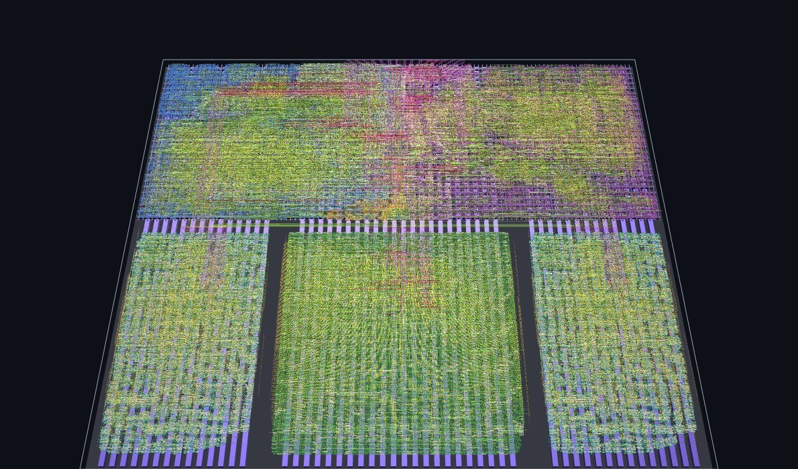

`ibex_npu_top` rendered from its routed GDS: 2.23 million wires, 441,319 cells and 853,576 vias, true scale.
Bottom: `u_sram0`, `u_acc` (systolic array), `u_sram1`; top: the Ibex core and its lockstep shadow.

## At a glance

| Item | Detail |
|---|---|
| **Process** | MATRIX-A5 CFET, `base` variant: 2-tier nanosheet (nFET over pFET), 3 sheets per device, 0.7 V, buried power rail + backside metals BSM1-3 |
| **CPU** | lowRISC Ibex `maxperf-pmp-bmfull`: RV32IMCB, 3-stage, single-cycle multiplier, 16-region PMP, SecureIbex dual-core lockstep |
| **Accelerator** | `npu_acc`: 8×8 output-stationary INT8 systolic array, 32-bit accumulators; `npu_dma` tiled-GEMM engine; 2 × 1 KB latch SRAM |
| **Chips** | `ibex_cfet_top` (CPU only, baseline) · `ibex_npu_top` (CPU + accelerator) |
| **Die** | `ibex_npu_top` 115.75 × 100.37 µm · `ibex_cfet_top` 70.04 × 70.13 µm · `npu_acc` 49.14 × 49.97 µm · `lram_256x32` 30.03 × 49.97 µm |
| **Clock** | 750 ps (1.33 GHz) for all four designs (`ibex_cfet_top` setup +8 ps, `ibex_npu_top` setup +1 ps) |
| **Result** | 16×16×16 INT8 GEMM: NPU chip 3.8× faster and 2.5× less energy than the CPU-only chip, at 2.4× the die area ([details](#cpu-vs-cpu--npu-performance-power-area)) |
| **Tools** | Genus 25.1 (iSpatial) · Innovus 25.1 · Quantus · IC Validator V-2023.12 · Conformal 22.2 · Xcelium · Verilator |
| **`ibex_npu_top` layout** | 161,728 logic cells + 279,591 fillers · 28,425 flip-flops/latches · 81,049 nets · 232 pins on M5 |

## Architecture

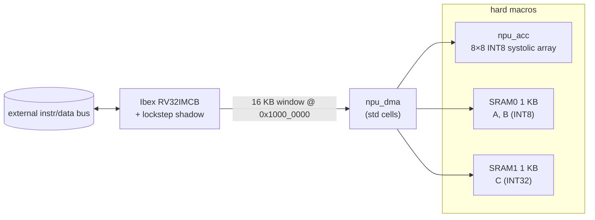

For each 8×8 tile the DMA copies A and B from SRAM0 into the array, starts it, and writes (k = 0) or accumulates
(k > 0) the 64 results into SRAM1, counting cycles. RTL simulation: 16×16×16 GEMM in 2,040 DMA cycles,
8×16×24 GEMM in 1,530.

## Floorplan

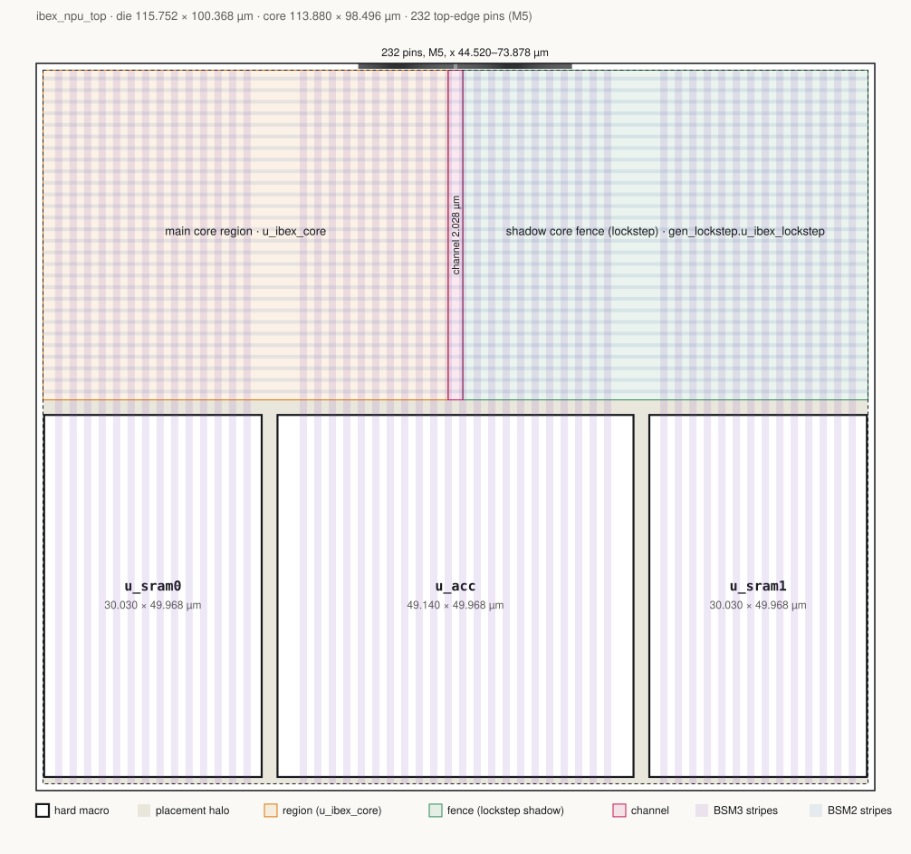

To scale.

The three macros sit in a row along the bottom; the CPU fills the band above them. The main Ibex core and its
lockstep shadow mirror each other about the die centre with a 2 µm channel between them for the register file,
glue logic and `npu_dma`. All 232 pins are on the top edge, `clk_i` on the centre line. Power is delivered from
the backside only.

| Placement (from the routed DEF) | Routing M0-M5 (from the routed DEF) |
|---|---|
| 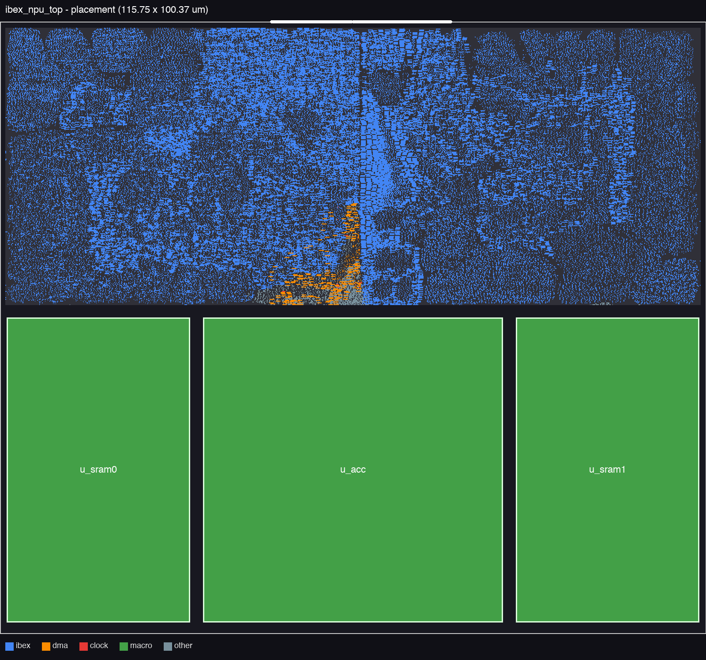 | 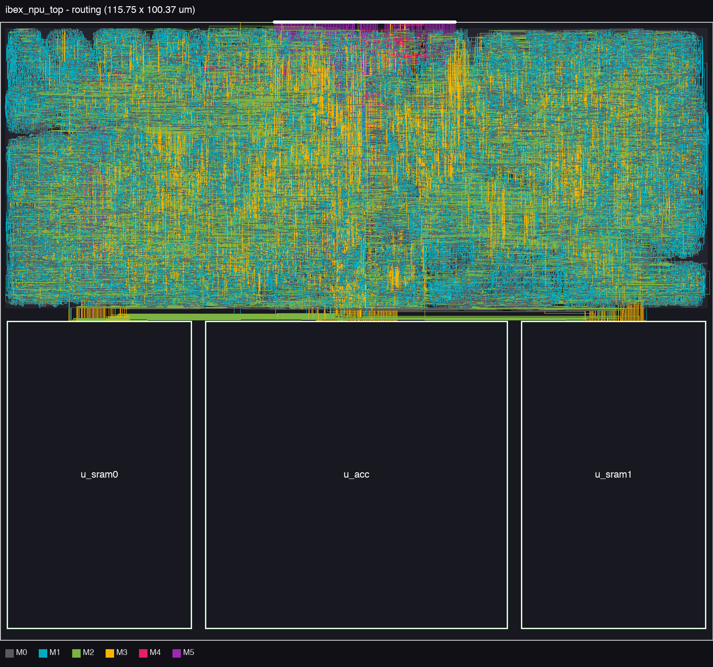 |

<b>The other three layouts</b> (<code>ibex_cfet_top</code>, <code>npu_acc</code>, <code>lram_256x32</code>)

| Design | Placement | Routing |
|---|---|---|
| `ibex_cfet_top` (CPU only) | 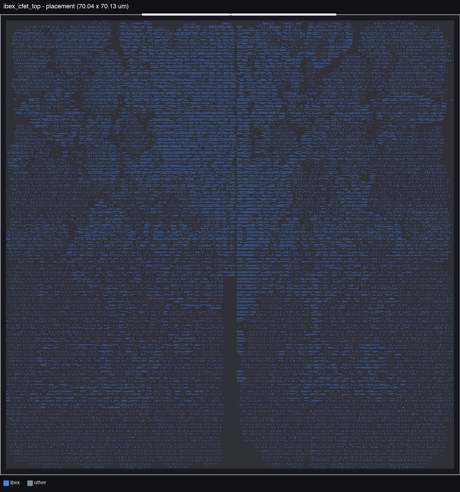 | 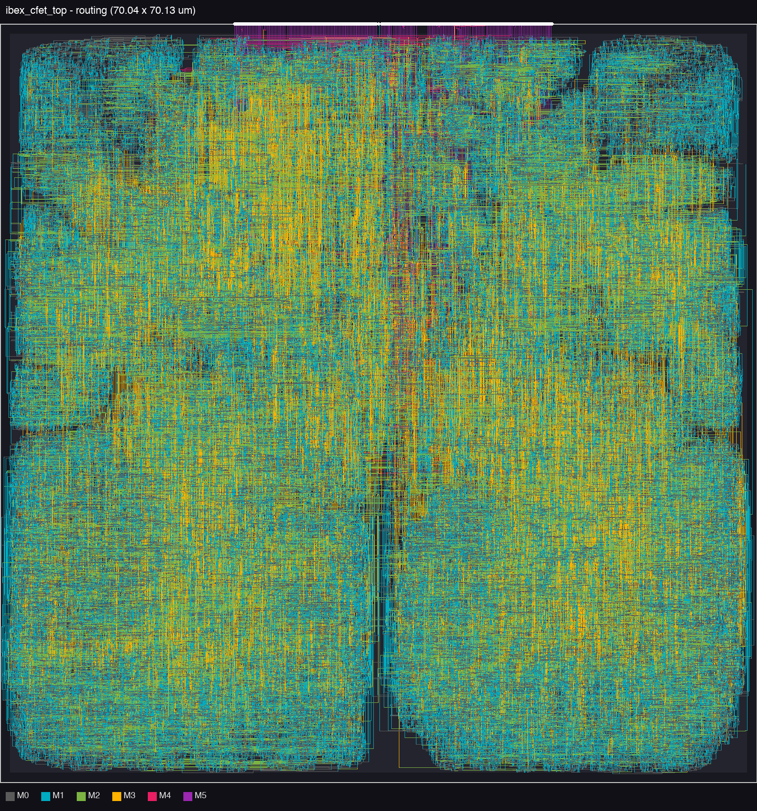 |
| `npu_acc` (systolic array) | 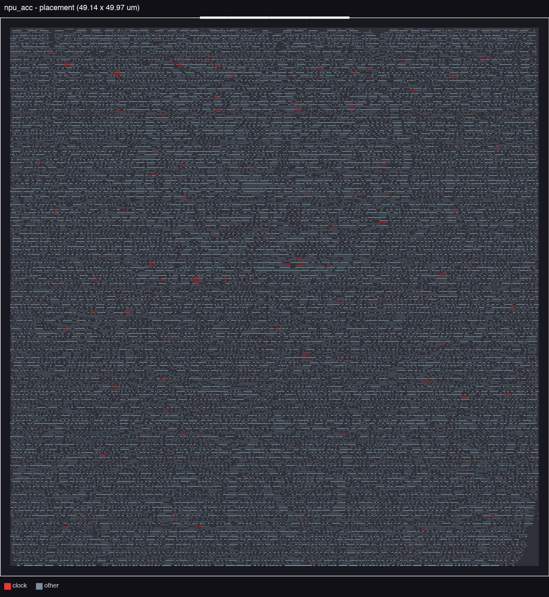 | 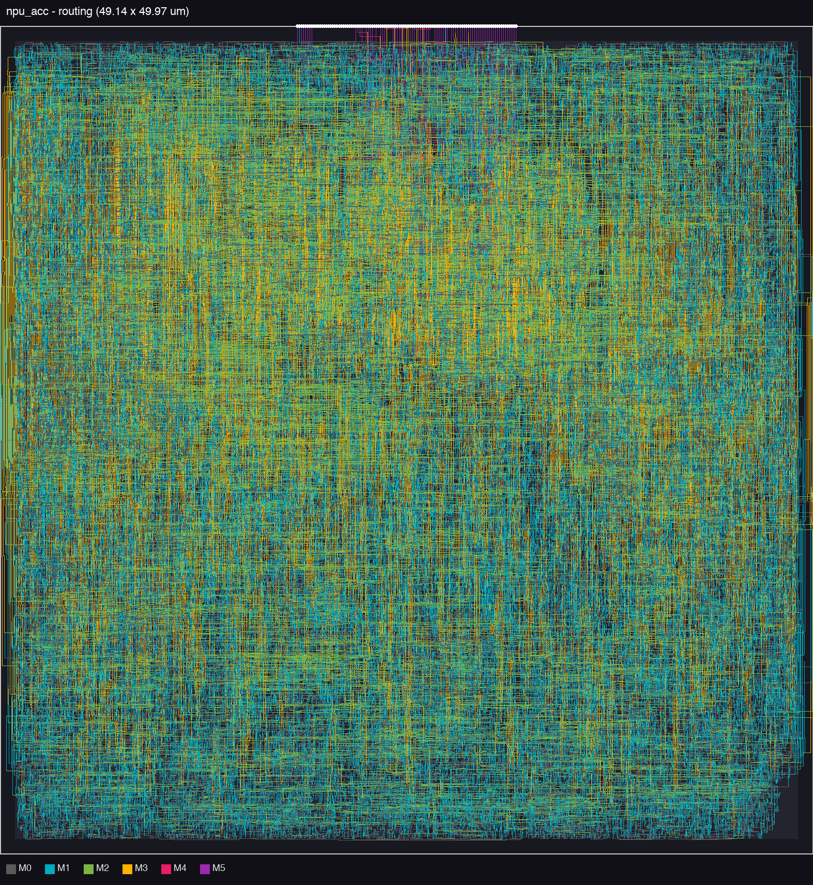 |
| `lram_256x32` (latch SRAM) | 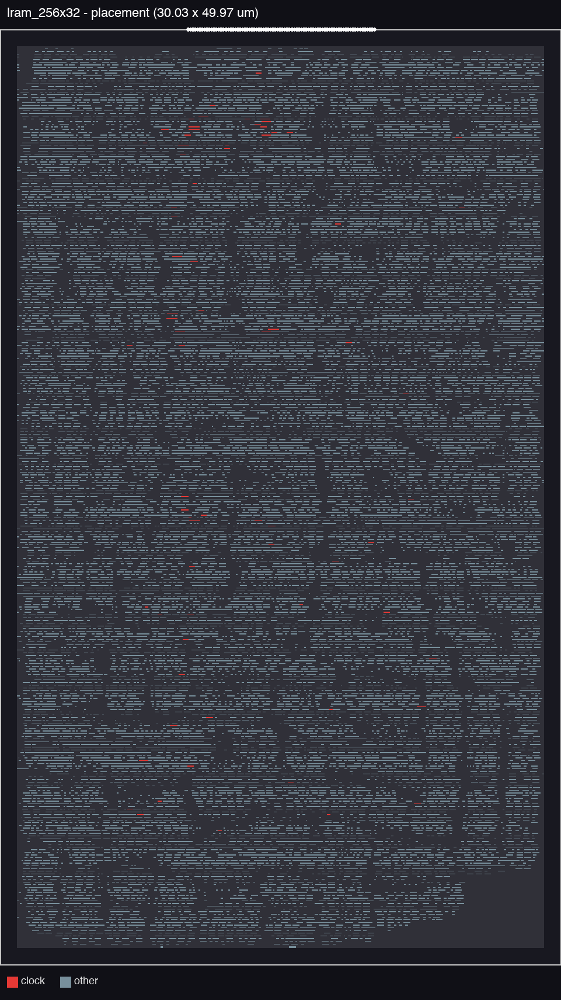 | 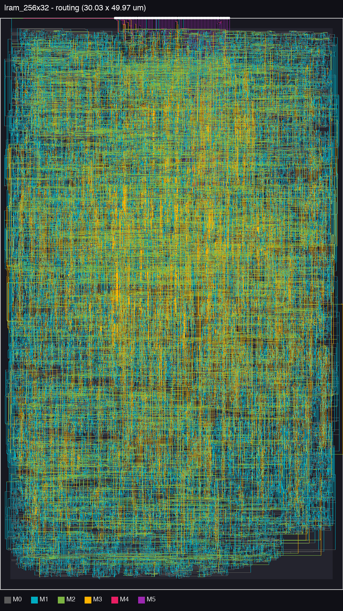 |

Rendered from the routed DEFs: cells coloured by block, macros in green, white dots = chip pins; wires coloured
by metal layer.

## The device: CFET with backside power

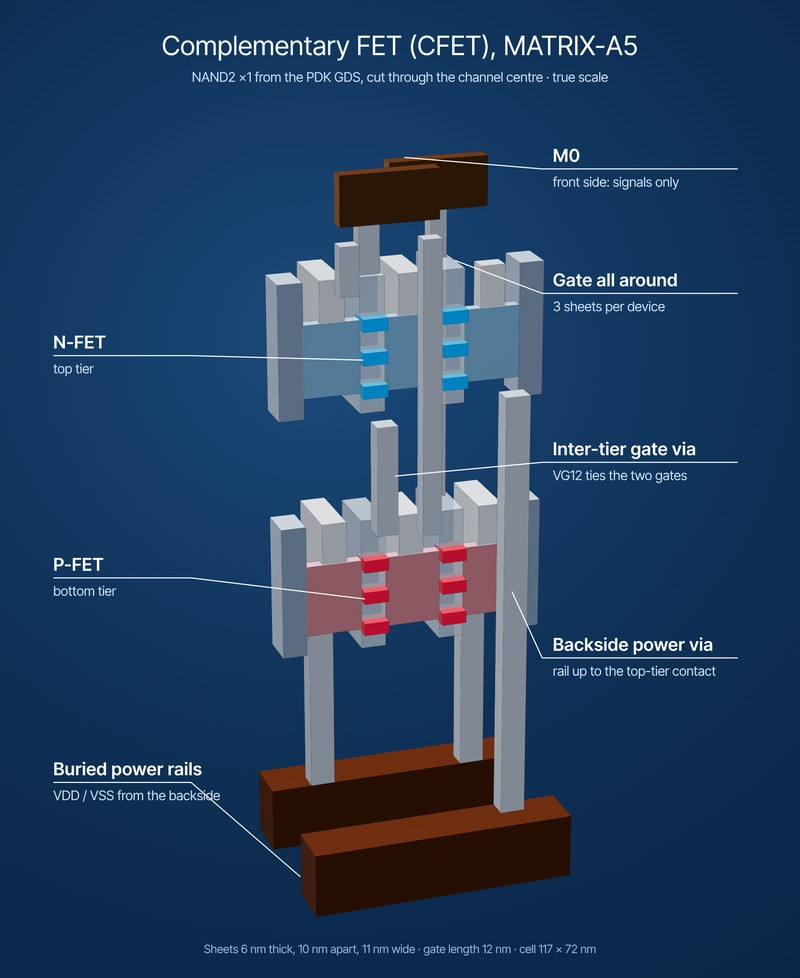

A complementary FET stacks the nFET directly on top of the pFET. In MATRIX-A5 each transistor is three 6 nm
nanosheets (10 nm apart, 11 nm wide, 12 nm gate) with the gate wrapped all the way round; the supply comes up
from the backside through a buried power rail, and the front-side metals M0-M13 carry signals only.

The figure is the PDK's NAND2 cell rendered from its GDS and device model, cut through the channel centre, at true
scale. Every cell in this chip has its 3D geometry and transistor list derived the same way, and all 191 logic
cell types used in the chip were checked against the PDK netlists.

 

## Clock tree

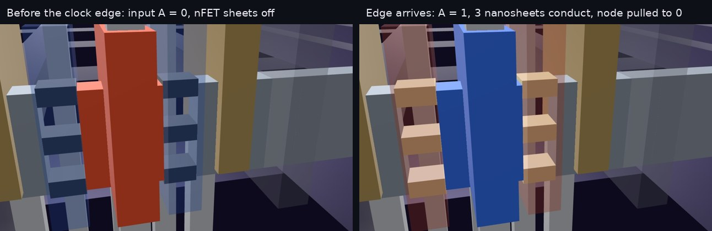

The clock network was traced through the routed layout from `clk_i` through **2,505 buffers, inverters and clock gates**, across
**14 stages** and into all three macros, to **all 28,425 flip-flop and latch clock pins**: every sequential element
in the design. Above: the edge reaching a `buf_x8` of the clock tree; the buffer's input goes high, the three
nanosheets of each nFET start to conduct and the internal node is pulled low (switch-level simulation of the
cell's own transistors).

The whole clock network lit up

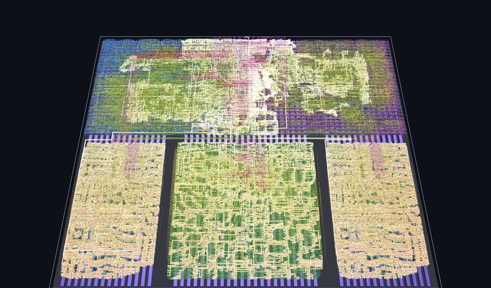

## Status

| Design | P&R | LVS | Innovus DRC | Timing | Post-P&R LEC |
|---|---|---|---|---|---|
| `lram_256x32` | done | PASS | clean | met, 750 ps | PASS |
| `npu_acc` | done | PASS | clean | met, 750 ps | PASS |
| `ibex_cfet_top` | done | PASS | clean | met, 750 ps: setup +8 ps, hold met | PASS |
| `ibex_npu_top` | done (9 post-route ECO rounds) | PASS | clean | 750 ps: setup +1 ps; hold -3 ps on one path (`u_acc/req_i`, fast corner), accepted and checked in fast-corner GLS | PASS (synthesis → P&R and RTL → P&R) |

Foundry DRC (IC Validator) has not been rerun on the final layouts.

## CPU vs CPU + NPU: performance, power, area

Benchmark: a 16×16×16 INT8 GEMM (4,096 MACs, INT32 results), run on the post-P&R gate-level netlists of both chips
at 750 ps (1.33 GHz). The CPU-only chip runs it in software; the NPU chip copies A and B into SRAM0, starts the
tiled-GEMM DMA, and copies C back. Testbench: `tb/bench/tb_gemm.sv`. Power is Innovus `report_power` at TT 25 °C with switching activity from the
fast-corner SDF gate-level simulation over the benchmark window (99.5-100 % of nets annotated); the macros are
reported from their own databases and added. Area is the die area.

| Configuration | Cycles | Latency | Power | GOPS | GOPS/W | GOPS/mm² | Energy | pJ/MAC | Speedup | Energy gain |
|---|---|---|---|---|---|---|---|---|---|---|
| CPU only (`ibex_cfet_top`), software | 18,000 | 13.50 µs | 8.80 mW | 0.61 | 69 | 124 | 118.8 nJ | 29.0 | 1.00× | 1.00× |
| CPU + NPU (`ibex_npu_top`), end to end | 4,750 | 3.56 µs | 13.33 mW | 2.30 | 173 | 198 | 47.5 nJ | 11.6 | **3.79×** | **2.50×** |
| CPU + NPU, DMA kernel only¹ | 2,040 | 1.53 µs | 13.33 mW | 5.35 | 402 | 461 | 20.4 nJ | 5.0 | 8.82× | 5.83× |
| CPU + NPU, software (NPU idle) | 18,000 | 13.50 µs | 14.33 mW | 0.61 | 42 | 52 | 193.4 nJ | 47.2 | 1.00× | 0.61× |

¹ A and B already in SRAM0; whole-run average power. Die areas: `ibex_cfet_top` 0.0049 mm², `ibex_npu_top`
0.0116 mm² (2.4×). Full table with energy-delay product, power breakdown per block and JSON: `docs/ppa_comparison.md`,
`docs/ppa_comparison.json`.

What the numbers say:

- **The accelerator wins on every efficiency metric despite 2.4× the area:** 3.8× faster, 2.5× less energy per GEMM,
  1.6× more GOPS/mm², 9.5× better energy-delay product end to end.
- **It is data-movement bound, not compute bound.** The 8×8 array can do 64 MACs per cycle (171 GOPS peak) but
  averages 2 MACs per cycle (3 % of peak) inside the DMA kernel: each 8×8×8 tile spends 35 cycles loading A/B a
  32-bit word at a time and 192 cycles reading the 64 results back, for 22 cycles of compute. End to end, the
  CPU copy loops (899 + 1,798 cycles) cost more than the GEMM itself (2,040).
- **An idle accelerator is not free.** Running the software GEMM on the NPU chip costs 61 % more energy than on the
  CPU-only chip (2.5 mW in the idle array, 1.8 mW in the two SRAMs): the library has no integrated clock-gating cell,
  so the macro clock trees toggle all the time.
- Next steps that follow from this: wide (64-128 bit) array load/drain ports, accumulation across k tiles inside the
  array, double-buffered tiles, a bus-master DMA instead of CPU copies, and latch-based clock gating of idle macros.

## Verification

| Check | `ibex_cfet_top` | `ibex_npu_top` |
|---|---|---|
| LVS (IC Validator) | PASS | PASS |
| LEC (Conformal): synthesis → P&R, RTL → P&R | PASS, PASS | PASS (macros black-boxed, each has its own PASS), PASS |
| GEMM benchmark, RTL (Verilator) | PASS, 18,000 cycles | PASS: software 18,000, NPU 4,750 cycles |
| GLS zero delay | see note² | PASS (software and NPU GEMM) |
| GLS fast corner (ffgm40 SDF, min) | PASS³, 0 timing violations | PASS, violations only before reset release |
| GLS slow corner (ssgm40 SDF, max) | PASS³ (GEMM correct); setup/hold warnings only on the flops that capture chip inputs | **open**⁴ |

² Passes with registers initialised at time 0; the uninitialised case is open. ³ With registers initialised
at time 0. ⁴ Under investigation; register-to-register timing is signed off by STA (setup met at both slow
corners).

### Fault injection: does the lockstep catch upsets?

Single-bit upsets were injected into flip-flops during the GEMM (RTL, Xcelium and Verilator agree;
`tb/bench/fault_inj.svh`):

| Fault | Detected by | Latency | Result |
|---|---|---|---|
| none (control) | – | – | correct, no alert |
| main core `pc_id` bit | main core's own PC check | same cycle | correct, alert |
| shadow core `pc_id` bit | shadow core internal alert | same cycle | correct, alert |
| register file `x10` bit | shadow core internal alert (lockstep register-read check) | 3 cycles | 228 wrong outputs, flagged |
| lockstep comparator register | output mismatch | same cycle | correct, alert |
| NPU array PE accumulator bit | **nothing** | – | **1 wrong output, silent** |

Every upset in the CPU raises `alert_major_internal`; an upset in the accelerator corrupts the result silently. The
alerts are pulses of one cycle or less and the core keeps running, so a system would need an alert handler that latches them.
Parity or a checksum on the array (or ECC on the accumulators) would close the accelerator gap.

## Repository layout

| Path | Contents |
|---|---|
| `rtl/` | Own RTL: `npu_acc`, `sysarr`, `sysarr_pe`, `npu_dma`, `lram_256x32` and both tops; `ibex_files.f` / `ibex_incdirs.txt` list the Ibex sources |
| `tb/` | RTL testbenches; `tb/bench/` is the GEMM benchmark and fault-injection testbench |
| `docs/` | `ppa_comparison.md/.json` (CPU vs NPU), `floorplan/` (floorplan and layout renders), `img/` (3D renders) |

This repository shows the design and the results. The implementation flow (synthesis, place-and-route, signoff and
benchmark scripts) and the PDK set-up are not published.

## Licences

- The 3D renders in `docs/img/` show cell geometry from the MATRIX-A5 PDK and are covered by the MATRIX-PDK
  Academic and Non-Commercial License. MATRIX-A5: M. Shon et al., IEEE JXCDC 2026,
  [doi:10.1109/JXCDC.2026.3744406](https://doi.org/10.1109/JXCDC.2026.3744406).
- Ibex is Apache-2.0 (lowRISC) and is not included.
